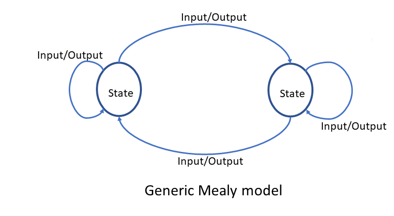
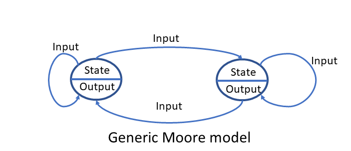

# What is State Machine?
- State Machine là một mô hình phần mềm tính toán và nó bao gồm các trạng thái số hữu hạn. Do đó, nó còn được gọi là Máy trạng thái hữu hạn (FSM-Finite State Machine)
- Vì các State là hữu hạn nên số lần chuyển đổi giữa các State là hữu hạn. Quá trình chuyển đổi được kích hoạt bởi các sự kiện đầu vào được cung cấp cho State Machine (FSM là hệ thống hướng sự kiện).
# Benefits of using state machines(FSMs)
- FSM rất hữu ích để mô hình hóa các ứng dụng phức tạp liên quan đến nhiều việc ra quyết định, tạo ra các đầu ra (hành động) khác nhau và xử lý các sự kiện khác nhau.
- Máy trạng thái được hiển thị thông qua sơ đồ máy trạng thái dưới dạng biểu đồ trạng thái, giúp giao tiếp dễ dàng giữa người phát triển và khách hàng.
- Giúp dễ dàng hình dung và thực hiện các thay đổi đối với hành vi của dự án.
- Ứng dụng phức tạp có thể được hình dung như một tập hợp các trạng thái khác nhau xử lý một tập hợp sự kiện cố định và tạo ra một tập hợp đầu ra cố định.
- Dễ dàng gỡ lỗi và bảo trì mã dễ dàng
- Có thể tái sử dụng cho các ứng dụng khác nhau
- Có thể mở rộng
# Mealy machine
- Trong Mealy machine, **đầu ra được tạo ra bởi máy trạng thái phụ thuộc vào các sự kiện đầu vào đưa vào máy trạng thái và trạng thái hiện tại của máy trạng thái**.
- **Đầu ra không được tạo ra bên trong trạng thái**

- Đặc điểm :
    - Đầu ra được biểu diễn cùng với mỗi đầu vào và được phân tách bằng dấu `/`.

    - Một `Output` (đầu ra) còn được gọi là `Input/Output Action` (Hành động Đầu vào/Đầu ra).

    - Trong mô hình Mealy, `Output` cũng được gọi là `Input action` (Hành động Đầu vào).

# Moore machine
- Trong Moore machine, đầu ra chỉ được xác định bởi trạng thái hiện tại của máy trạng thái và không phụ thuộc vào bất kỳ sự kiện đầu vào nào.
- Không có đầu ra trong quá trình chuyển trạng thái

- Đặc điểm : 
    - **Đầu ra được biểu diễn bên trong trạng thái**: Điều này có nghĩa là đầu ra chỉ phụ thuộc vào trạng thái hiện tại mà máy trạng thái đang ở, không phụ thuộc vào sự kiện đầu vào. Khi máy ở trạng thái nào, nó sẽ tạo ra đầu ra tương ứng với trạng thái đó.

    - **`Output` cũng gọi là  `Action`**: Đầu ra ở đây còn được gọi là một "Hành động" vì nó là tác vụ hoặc phản hồi mà máy trạng thái thực hiện khi ở một trạng thái cụ thể.

    - **Trong mô hình Moore, `Output` còn được gọi là `Entry action`**: Vì đầu ra chỉ xuất hiện khi máy vào trạng thái mới (entry), nó cũng được gọi là "Hành động đầu vào"