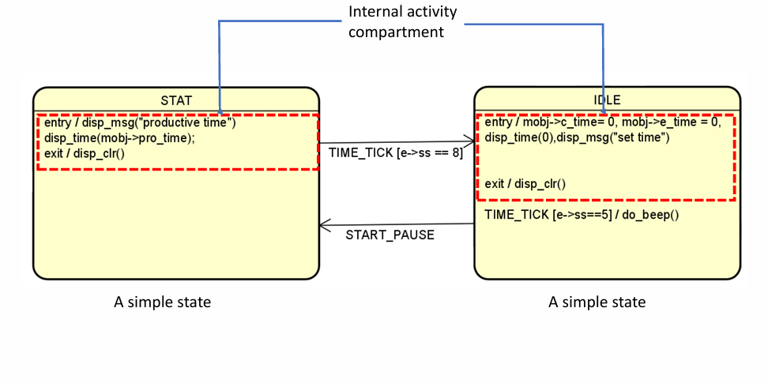
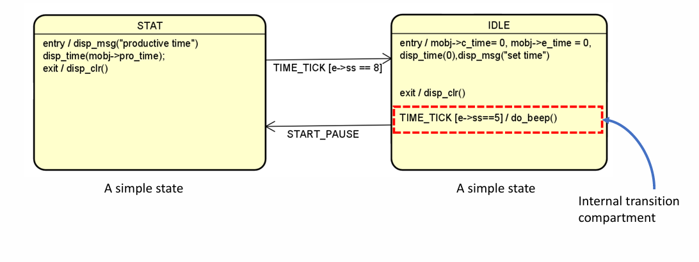
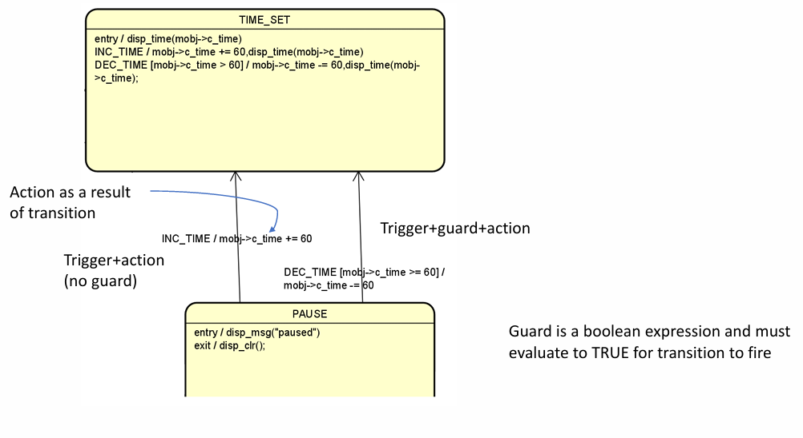
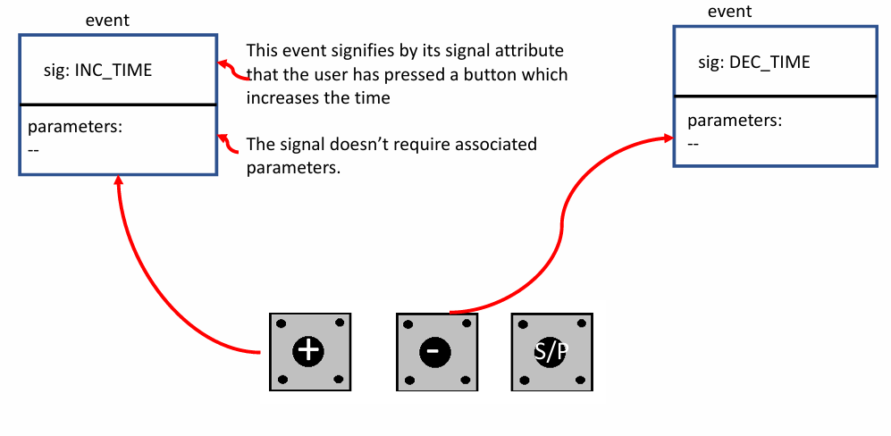
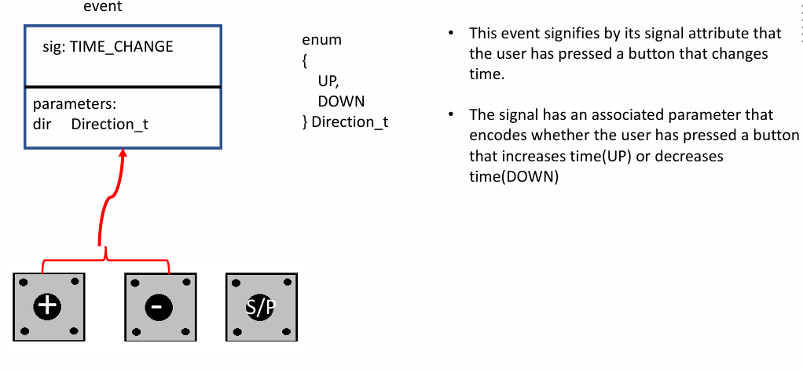
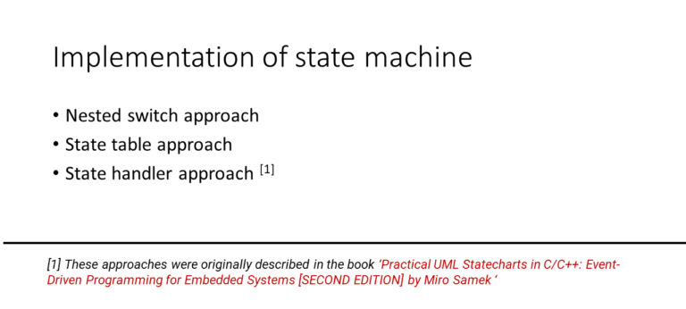

# State
## What is the state ? 
- Trong lập trình và mô hình hóa hệ thống, `State` là trạng thái đại diện cho một **giai đoạn riêng biệt trong vòng đời** của một đối tượng.
- Một `State` mô hình hóa một tình huống trong quá trình thực thi của **StateMachine Behavior** (hành vi của máy trạng thái) trong đó một điều kiện bất biến (invariant condition) được giữ nguyên. Trong hầu hết các trường hợp, điều kiện này không được định nghĩa rõ ràng mà được ngụ ý, thường thông qua tên gắn với State đó (theo định nghĩa từ OMG® UML 2.5.1).
- Để xác định hoặc "sửa" một trạng thái cho đối tượng,cần phân tích các tình huống (hoặc các sự kiện) khác nhau mà đối tượng có thể gặp phải trong vòng đời của nó, từ khi bắt đầu đến khi kết thúc.
## How to create a state ?
- **Vẽ một hình chữ nhật bo tròn**: Trạng thái thường được biểu diễn bằng một hình chữ nhật có góc bo tròn để phân biệt với các thành phần khác trong sơ đồ máy trạng thái (State Machine Diagram).

- **Tạo một ngăn tên nằm ngang**: Phía trong của hình chữ nhật bo tròn, tạo một ngăn nằm ngang (ngăn tên) để đặt tên cho trạng thái.

- **Đặt tên duy nhất**: Đặt tên cho trạng thái, đảm bảo tên này là **duy nhất** trong sơ đồ máy trạng thái đó. Tên trạng thái nên mang ý nghĩa rõ ràng về điều kiện hoặc tình huống mà đối tượng đang ở.
# Internal Activities Compartment
Internal Activities Compartment (ngăn hoạt động nội bộ) là một phần trong biểu diễn của một trạng thái trong UML. Ngăn này chứa danh sách các hành vi nội bộ gắn liền với trạng thái đó, mô tả các hành động xảy ra khi đối tượng ở trong trạng thái này mà không gây ra sự chuyển tiếp đến trạng thái khác.

Cấu trúc của một Internal Activities Compartment **\<behavior-type-label>[‘/’ \<behavior-expression>]**:

- **\<behavior-type-label>**: Nhãn loại hành vi (ví dụ, các nhãn được định nghĩa sẵn như `entry`, `exit`, và `do`).
- **[‘/’ \<behavior-expression>]**: Biểu thức hành vi (thường là các hành động cụ thể được thực hiện khi đối tượng ở trong trạng thái).

Chú ý : Không sử dụng các từ khóa `entry`, `exit`, và `do` để biểu diễn các sự kiện trong sơ đồ máy trạng thái.

# Internal Activity Labels
- Internal Activity Labels trong UML giúp xác định khi nào các hành vi cụ thể (biểu thức hành vi - 
**\<behavior-expression>**) sẽ được thực hiện trong một trạng thái.
- `etry`: Chạy biểu thức hành vi ngay khi đối tượng đi vào trạng thái (**thực thi 1 lần khi được kích hoạt**).
- `exit`: Chạy biểu thức hành vi khi đối tượng rời khỏi trạng thái.
- `do` : Chạy biểu thức hành vi **liên tục khi đối tượng ở trong trạng thái hoặc cho đến khi hành vi hoàn tất**.

# Internal Transition
- Internal Transition trong UML là một hành vi được thực thi bên trong một trạng thái mà không cần rời khỏi hoặc quay lại trạng thái đó.
- Mỗi mục trong một internal transition có cú pháp như sau: **{\<trigger>}\* ['[' \<guard> ']'] [ / \<behavior-expression> ]**

- **{\<trigger>}**: Đây là sự kiện kích hoạt (trigger) cho phép hành vi diễn ra khi một sự kiện cụ thể xảy ra. Trigger là tùy chọn, nhưng nếu có, sự kiện này phải xảy ra để hành vi bắt đầu.

- **['[' \<guard> ']']**: Điều kiện bảo vệ (guard) là một biểu thức logic phải trả về TRUE để kích hoạt hành vi. Nếu điều kiện này không đúng, hành vi sẽ không xảy ra dù trigger đã kích hoạt.

- **[/ \<behavior-expression>]**: Đây là hành vi được thực hiện nếu trigger và guard (nếu có) đều thỏa mãn. Hành vi này diễn ra trong khi đối tượng vẫn ở trong cùng trạng thái, không cần rời khỏi hay quay lại trạng thái đó.

# External Transition
- Trong **external transition (chuyển tiếp bên ngoài)**, trạng thái nguồn (source state) sẽ được thoát khỏi do một trigger (sự kiện kích hoạt) xảy ra.
- Khi sự kiện kích hoạt xảy ra, đối tượng thực hiện một hành động tùy chọn được gắn với chuyển tiếp này, sau đó là hành động thoát khỏi trạng thái hiện tại.
- **External transition** cho thấy sự thay đổi trạng thái hoặc tình huống của đối tượng trong vòng đời của nó. Điều này có nghĩa là trạng thái của đối tượng đã thay đổi, và nó sẵn sàng xử lý các sự kiện mới cũng như thực thi các hành động mới.
- Trong sơ đồ máy trạng thái, các chuyển tiếp được biểu diễn bằng **đường có mũi tên từ trạng thái nguồn đến trạng thái đích**.
- Transition trong UML được mô tả bằng một cú pháp rõ ràng, cho phép xác định cách mà một đối tượng chuyển từ trạng thái này sang trạng thái khác. Dưới đây là chi tiết về các cú pháp của transition:
    - **{\<trigger>}\* ['[' \<guard> ']'] [ / \<behavior-expression> ]**
    - **{\<trigger>} [\<guard>] / \<action>**
    - **event [\<guard>] / action**

# Events
- Events là các sự cố hoặc kích thích (stimulus) mà thông qua đó một máy trạng thái (state machine) có thể được kích hoạt. Các sự cố này thường được trừu tượng hóa dưới dạng sự kiện trong các mô hình máy trạng thái.

- Trong state machine event chính là tác nhân **Kích hoạt Chuyển Tiếp** trong một máy trạng thái, các sự kiện gây ra các chuyển tiếp (transitions) giữa các trạng thái, có thể là chuyển tiếp bên ngoài (external) hoặc bên trong (internal).
- Một Event bao gồm 2 thành phần :
    - `Signal` : Tín hiệu là phần chính xác định sự kiện. Nó đại diện cho sự xảy ra của một điều gì đó mà kích hoạt một chuyển tiếp giữa các trạng thái. Tín hiệu có thể được coi là một "tin nhắn" cho biết rằng điều gì đó đã xảy ra, khiến máy trạng thái phản ứng lại.Ví dụ: Trong một lò vi sóng, một tín hiệu có thể là "INC_TIME" hoặc "DEC_TIME" mà không cần thêm các giá trị tham số liên quan.
    
    - `one or more associated values or parameters (optional)` - Một hoặc nhiều các giá trị tham số liên quan : Đây là những thông tin bổ sung có thể đi kèm với tín hiệu. Chúng cung cấp ngữ cảnh hoặc chi tiết về sự kiện và có thể ảnh hưởng đến cách mà máy trạng thái phản ứng với sự kiện.
    Ví dụ: Khi gửi tín hiệu "TIME_CHANGE" các tham số có thể bao gồm các parameter cụ thể về nút bấm như "UP" hoặc "DOWN"
    

# Các cách tiếp cận State Machine

## Nested switch approach (Cách tiếp cận switch lồng nhau)
- Đây là một trong những phương pháp đơn giản và phổ biến nhất khi xây dựng máy trạng thái trong C/C++.
- Phương pháp này sử dụng các câu lệnh switch lồng nhau hoặc if-else để kiểm tra trạng thái hiện tại và quyết định hành động tiếp theo dựa trên đầu vào.
- Cấu trúc cơ bản bao gồm một switch statement bên ngoài để xử lý trạng thái hiện tại, và các case bên trong để xử lý đầu vào tương ứng.
- Ưu điểm
    - Dễ hiểu và dễ triển khai cho các hệ thống nhỏ.
    - Dễ đọc và trực quan khi số lượng trạng thái và đầu vào ít.
    - Không cần sử dụng các cấu trúc dữ liệu phức tạp.
- Nhược điểm
    - Khi số lượng trạng thái và đầu vào tăng lên, code có thể trở nên rất phức tạp và khó bảo trì.
    - Dễ dẫn đến mã nguồn cồng kềnh khi phải thêm nhiều điều kiện lồng nhau.
    - Khó mở rộng và dễ mắc lỗi nếu không quản lý tốt các điều kiện.

## State table approach (Bảng Trạng Thái)
- Phương pháp này sử dụng một bảng (thường là mảng 2 chiều) để biểu diễn các trạng thái, đầu vào, và chuyển tiếp trạng thái.
- Mỗi hàng trong bảng đại diện cho một trạng thái cụ thể, và các cột đại diện cho các đầu vào có thể xảy ra.
- Bảng này giúp xác định trạng thái kế tiếp dựa trên trạng thái hiện tại và đầu vào.
- Ưu điểm
    - Dễ bảo trì khi hệ thống có nhiều trạng thái và đầu vào.
    - Trực quan và dễ hiểu khi nhìn vào bảng để xác định trạng thái tiếp theo.
    - Giảm thiểu việc sử dụng switch hoặc if-else lồng nhau.
- Nhược điểm
    - Khi số lượng trạng thái và đầu vào lớn, bảng có thể trở nên cồng kềnh và khó quản lý.
    - Tốn bộ nhớ hơn vì phải lưu trữ toàn bộ bảng.
## State handler approach (Bộ xử lý trạng thái)
- Trong phương pháp này, mỗi trạng thái được biểu diễn bởi một hàm riêng biệt (state handler function).
- Một con trỏ hàm (function pointer) sẽ trỏ tới trình xử lý trạng thái hiện tại. Dựa vào con trỏ hàm, hệ thống có thể chuyển đổi giữa các trạng thái mà không cần các câu lệnh switch bên ngoài.
- Khi chuyển đổi trạng thái, bạn chỉ cần thay đổi con trỏ hàm thành hàm xử lý tương ứng với trạng thái mới.
- Ưu điểm
    - Modular và dễ bảo trì vì mỗi trạng thái có một hàm riêng biệt.
    - Dễ mở rộng khi thêm trạng thái mới mà không cần thay đổi mã nguồn hiện tại.
    - Tối ưu hóa hiệu suất vì không cần sử dụng switch lồng nhau.
- Nhược điểm
    - Phức tạp hơn so với các phương pháp khác đối với những người mới học C/C++.
    - Cần hiểu rõ về con trỏ hàm để triển khai đúng.