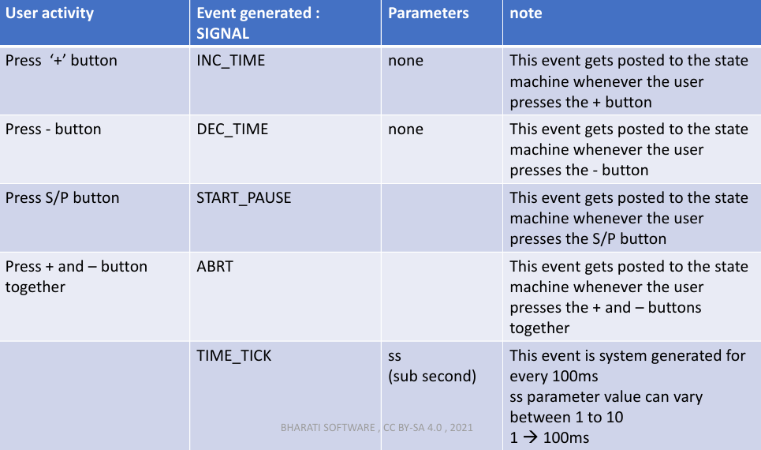
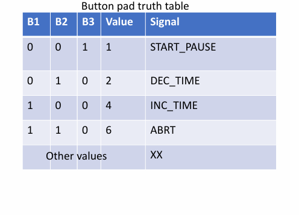

# Project : Protimer
Ứng dụng theo dõi thời gian làm việc của bạn
## Project requiments
Mô tả các nút :
- Nút + → Thời gian tăng (số phút sẽ tăng) 
- Nút - → Thời gian giảm (số phút sẽ giảm) 
- Nút S/P → Bắt đầu/tạm dừng đếm ngược; hiển thị STAT 
- Khi tạm dừng đếm ngược, thời gian có thể được sửa đổi
- Nhấn đồng thời nút + và – để hủy bộ hẹn giờ đang chạy 
-  Ứng dụng phải phát ra tiếng bíp 20 lần khi trở về chế độ IDLE 
- Khi ứng dụng ở chế độ IDLE, nhấn nút S/P sẽ hiển thị STAT trong 1 giây và tự động quay lại sang chế độ IDLE.

## States
- IDLE
- TIME-SET
- COUNTDOWN
- PAUSE
- STAT

## Events

##  Button truth table

##
