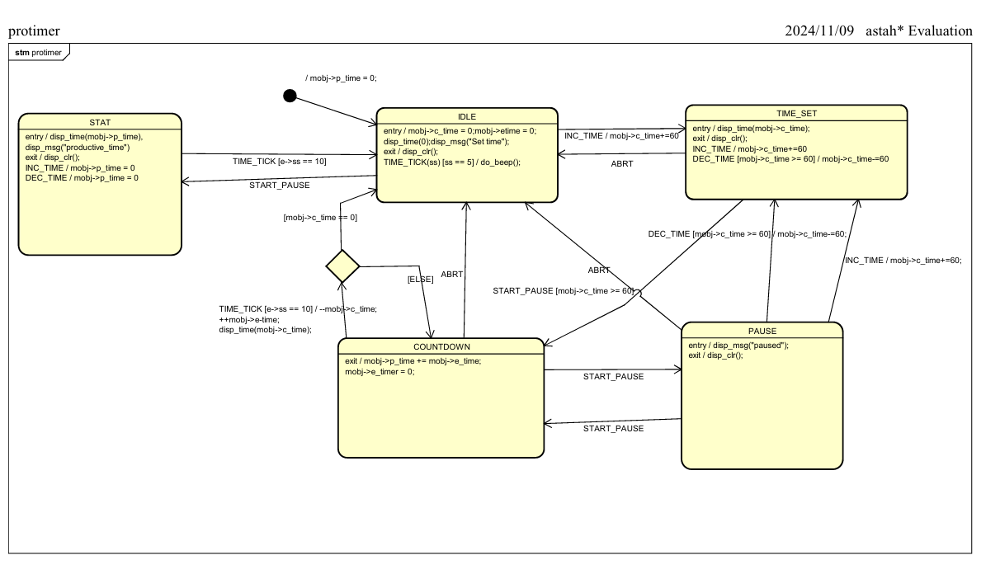
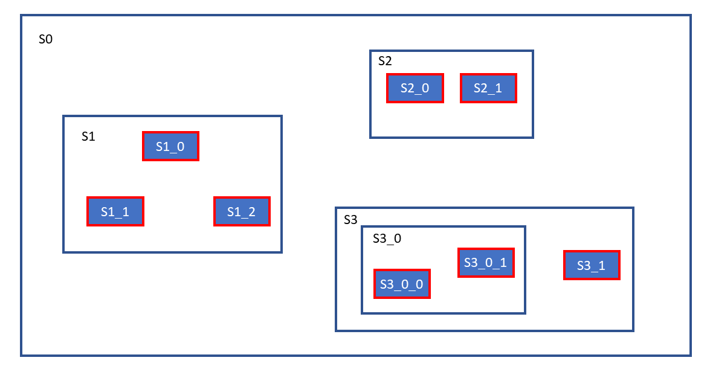
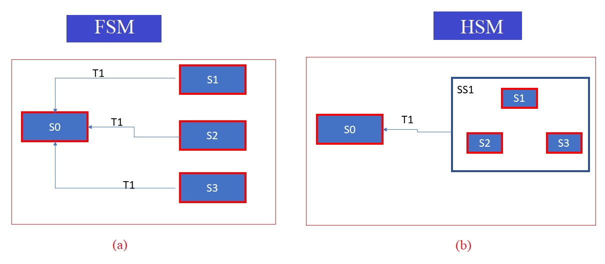
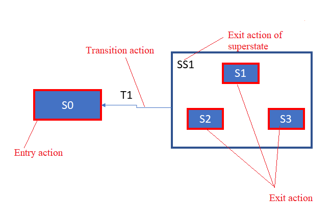
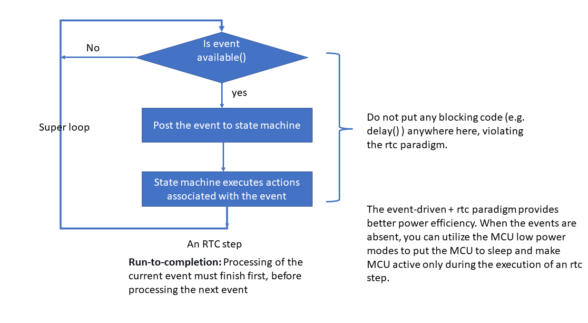

# Hierarchical State Machines(HSMs)
## Overview
- Trong các phần trước ta đang dùng máy trạng thái phẳng (FSM) tức là không có trạng thái tổng hợp.Không có bất kỳ trạng thái nào
được nhúng trong các trạng thái khác.Sơ đồ sẽ có một vài trạng thái kết nối với nhau bằng một vài mũi tên.
Nhưng các mũi tên đó chỉ là các mũi tên chuyển tiếp bên ngoài(External transition).Như hình sau:

- Máy trạng thái phẳng này chỉ thích hợp cho các ứng dụng có ít trạng thái vì nó dễ quản lý. Nhưng khi muốn thêm nhiều tính năng cho ứng dụng, có thể cần thêm nhiều trạng thái hơn. Và khi thêm nhiều trạng thái, chắc chắn sẽ có nhiều chuyển tiếp giữa các trạng thái, nhiều điều kiện bảo vệ (Guard conditions), làm cho việc vẽ sơ đồ máy trạng thái trở nên phức tạp.

- Khi độ phức tạp của sơ đồ máy trạng thái tăng lên, việc duy trì, hình dung và xử lý sự cố trở nên cực kỳ khó khăn. Đó là lý do tại sao việc khám phá máy trạng thái phân cấp (HSMs) là rất quan trọng để giải quyết vấn đề này.

- Máy trạng thái phân cấp (HSMs) sẽ giúp giảm thiểu đáng kể độ phức tạp do phương pháp máy trạng thái phẳng(FSM) mang lại.

## Disadvantages of using a Flat state machine(FSM)
- Khi số lượng trạng thái tăng lên, số lượng chuyển tiếp giữa các trạng thái cũng sẽ tăng, làm tăng độ phức tạp.
- Khó vẽ, hình dung, theo dõi và khắc phục sự cố.
- Dễ mắc phải lỗi do bỏ sót các chuyển tiếp.
- Lặp lại mã (không hiệu quả trong việc tái sử dụng mã).

## FSM vs. HSM

- Xét ví dụ như hình trên có thể thấy S1_0, S1_1, S1_2 không phải là trạng thái con của trạng thái cha S0.S1,S2 và S3 là các trạng thái con trực tiếp của trạng thái cha S0. Như vậy có 3 cấp độ phân cấp ở ví dụ trên.
- Bây giờ giả sử có 3 trạng thái: S1, S2, và S3. Và tất cả chúng có hành vi chung.Hành vi chung, mỗi khi kích hoạt T1 xảy ra, trạng thái của ứng dụng sẽ chuyển từ trạng thái này sang trạng thái khác.

- Ví dụ, hãy nhìn vào hình (a). Hiện tại, trạng thái ứng dụng là S2, khi trigger T1 xảy ra, trạng thái ứng dụng sẽ chuyển từ S2 sang S0, đó là sự chuyển đổi bên ngoài. Và hành vi này cũng giống ở các trạng thái S1, S2, S3. Nó đang bị trùng lặp các chuyển trạng thái. Đó là lý do tại sao nó có thể gợi ý rằng chúng ta có thể chuyển đổi sơ đồ máy trạng thái (a) này thành sơ đồ (b) này bằng cách sử dụng phương pháp phân cấp.
- Trong hình (b), SS1 là trạng thái tổng hợp hoặc siêu trạng thái bao gồm 3 trạng thái con; S1, S2 và S3. Và nó kế thừa hành vi chung của ba trạng thái này cho chính nó. Khi ứng dụng ở trạng thái S1 khi kích hoạt T1 xảy ra, ý nghĩa của sơ đồ này là (b), S1 không xử lý T1. Đó là lý do tại sao trigger lan truyền đến siêu trạng thái của nó, tức là SS1. Và SS1 xử lý nó và có sự chuyển đổi sang S0. Đó là ý nghĩa của sơ đồ máy trạng thái này. Điều tương tự cũng được áp dụng cho các trạng thái S2, S3. Khi trạng thái ứng dụng ở S2 và khi T1 xảy ra, S2 không xử lý T1. Do đó, nó truyền đến siêu trạng thái của nó và SS1 xử lý nó, đồng thời trạng thái chuyển sang S0.

- Lợi ích của HSM là độ phức tạp được giảm bớt. Và cũng có thể kiểm soát việc lặp mã.

- Ví dụ, trong Máy trạng thái phẳng hành động chuyển tiếp T1 phải được đề cập ở ba nơi. Nhưng trong HSM, chỉ cần đề cập hành động chuyển tiếp T1 ở một nơi. Vậy một nơi có nghĩa là chỉ có một điểm điều khiển; chỉ có một nơi cần thay đổi điều gì đó nếu bạn muốn làm như vậy. Đó là lý do tại sao HSM giúp giảm thiểu việc lặp mã. 

## Run - to - completion
- Mô hình Run-to-completion (RTC) là một mô hình xử lý sự kiện phổ biến trong các hệ thống nhúng và các ứng dụng thời gian thực. 
- Khái niệm cơ bản của RTC là: **một sự kiện đang được xử lý phải hoàn tất trước khi hệ thống có thể xử lý sự kiện tiếp theo.**
- Có nghĩa là : Khi một sự kiện được tạo ra, máy trạng thái sẽ tiếp nhận và xử lý sự kiện đó một cách hoàn chỉnh trước khi chuyển sang sự kiện kế tiếp.
Hệ thống không cho phép bất kỳ sự kiện nào khác chen vào trong quá trình xử lý một sự kiện hiện tại.
### Run-to-completion(RTC) pattern

- Quy trình hoạt động của RTC :
    - Bước 1: Kiểm tra sự kiện — Hệ thống đầu tiên sẽ kiểm tra xem có sự kiện nào được tạo ra và sẵn sàng để xử lý hay không.
    - Bước 2: Xử lý sự kiện — Nếu có sự kiện, hệ thống sẽ gửi (post) sự kiện đó đến máy trạng thái (State Machine).
    - Bước 3: Thực hiện hành động — Máy trạng thái sẽ xử lý sự kiện đến khi hoàn tất (được gọi là "run to completion"). Tức là nó sẽ thực hiện tất cả các hành động liên quan đến sự kiện đó mà không bị gián đoạn.
    - Bước 4: Trở về vòng lặp chính — Sau khi máy trạng thái hoàn thành xử lý sự kiện, hệ thống sẽ trở về vòng lặp chính (super loop) để tiếp tục kiểm tra sự kiện khác.
- Tóm lại : Run - to - completion (RTC) Việc xử lý sự kiện hiện tại phải hoàn thành trước khi xử lý sự kiện tiếp theo. Nếu bạn sử dụng mô hình chạy đến khi hoàn thành, bạn không nên đặt bất kỳ blocking code nào (ví dụ: delay()) ở bất kỳ đâu tại đây, vi phạm mô hình rtc.
- Nếu bạn cho phép delay trong một bước StateMachine, nó có thể khiến hệ thống ngừng xử lý sự kiện trong một khoảng thời gian và khiến các sự kiện chờ xử lý không được tiếp nhận cho đến khi delay kết thúc. Điều này làm mất đi tính liên tục và đồng bộ trong việc xử lý sự kiện mà RTC mong muốn.
### IMPLEMENTATION NOTE
- Mô hình run-to-completion thường bị hiểu sai rằng khi một StateMachine đang thực thi thì không thể bị ngắt quãng (interrupted). Nếu như điều này đúng, sẽ dẫn đến vấn đề đảo ngược độ ưu tiên (priority inversion) trong một số hệ thống có yêu cầu cao về thời gian (time-sensitive systems).
Tuy nhiên, thực tế không phải như vậy. Trong một triển khai cụ thể, một luồng (thread) đang thực thi một bước của StateMachine có thể bị tạm dừng (suspended) để nhường tài nguyên cho các luồng khác có độ ưu tiên cao hơn.
Sau đó, khi bộ lập lịch luồng (thread scheduler) phân bổ lại thời gian xử lý cho luồng đang bị tạm dừng đó, nó có thể tiếp tục thực thi một cách an toàn và hoàn thành quá trình xử lý sự kiện mà nó đang thực hiện trước đó.
- Tóm lại : 
 RTC đảm bảo sự kiện hiện tại phải hoàn thành trước khi xử lý sự kiện tiếp theo.

=> **Với Run - to - completion không có nghĩa là không thể tạm dừng.Quá trình xử lý có thể bị tạm dừng để nhường chỗ cho các luồng (ngắt) có mức ưu tiên cao hơn** ***(nhưng khi tiếp tục, nó sẽ quay lại hoàn thành sự kiện đang xử lý dở)***.

## QP Framework
- Khi làm việc với máy trạng thái phân cấp (hierarchical state machines - HSM), bạn sẽ gặp phải vấn đề là các trạng thái trong máy trạng thái này có thể được lồng vào nhau. Điều này có nghĩa là mỗi trạng thái có thể chứa các trạng thái con, và các trạng thái con này lại có thể có các trạng thái con của riêng mình, tạo thành một cấu trúc phân cấp phức tạp. 
Việc xử lý và duyệt qua tất cả các trạng thái này, đặc biệt là khi có các chuyển tiếp trạng thái (state transitions), sẽ trở nên rất phức tạp nếu làm thủ công.
- QP Framework: Đây là một framework nhúng thời gian thực (real-time embedded framework) của Quantum Leaps, LLC. Nó cung cấp các công cụ và kỹ thuật để triển khai máy trạng thái phân cấp và xử lý các sự kiện trong các hệ thống nhúng. Framework này giúp bạn tránh phải viết mã xử lý sự kiện phức tạp bằng cách cung cấp các lớp (classes) và phương thức đã được tối ưu hóa để xử lý các sự kiện và chuyển tiếp trong các máy trạng thái phân cấp.

- QM Tool: QM là một công cụ mô hình hóa đồ họa giúp bạn mô hình hóa và thiết kế các máy trạng thái phân cấp và các chuyển tiếp của chúng. Thông qua QM, bạn có thể tạo ra một mô hình đồ họa của hệ thống trạng thái, từ đó sinh mã nguồn tự động cho việc triển khai. Điều này giúp giảm thiểu sai sót trong quá trình thiết kế và đảm bảo tính chính xác trong hệ thống.